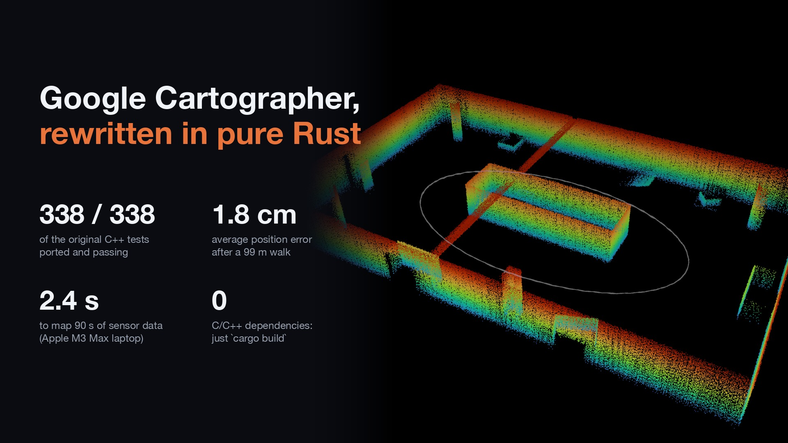
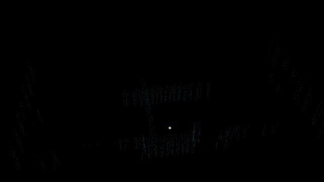
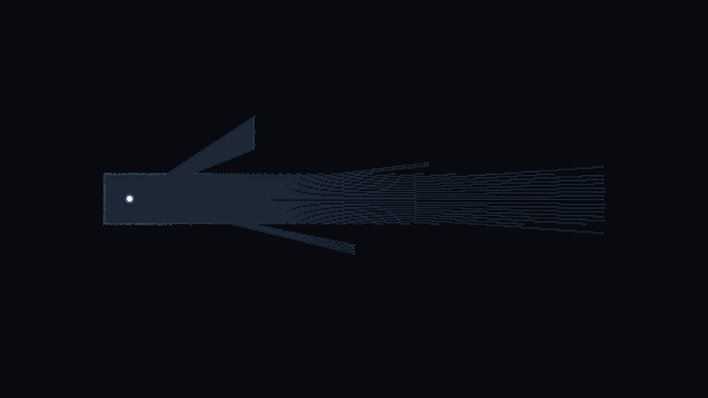

# cartographer-rust



A native, pure-Rust port of [Google Cartographer](https://github.com/cartographer-project/cartographer):
2D and 3D LiDAR + IMU + odometry + landmark SLAM with submaps, real-time
correlative / Ceres / branch-and-bound scan matching, and a sparse pose graph
with loop closure.

* **Faithful.** Module structure, type names, algorithms, constants and
  default parameters follow the C++ source file by file. Every one of the
  338 C++ test cases (`*_test.cc`) has a passing Rust port; see
  [`PORTING_STATUS.md`](PORTING_STATUS.md).
* **Builds anywhere with `cargo build`.** No C/C++ toolchain, no system
  libraries, no `protoc`, no Docker. Ceres, Lua and Cairo are replaced by
  focused pure-Rust ports; see [`DEPENDENCIES.md`](DEPENDENCIES.md).
* **Compatible.** Reads the original `configuration_files/*.lua` unchanged,
  and reads/writes `.pbstream` files with byte-identical `.proto` schemas.
* **Easy to use.** A small high-level API (`cartographer::Slam`) sits on top
  of the faithful layer for people who just want a map.

## Demo

**3D:** a map built from a simulated Unitree L1 LiDAR + IMU (MuJoCo), 90 s of
data, revealed scan by scan. Click for the full video
([`map_3d.mp4`](docs/media/map_3d.mp4), 720p).

[](docs/media/map_3d.mp4)

**2D:** Cartographer's occupancy grid (`Slam::map_2d()` snapshots) while a
simulated robot tours an office twice. Click for the full video
([`map_2d.mp4`](docs/media/map_2d.mp4)).

[](docs/media/map_2d.mp4)

Regenerate: `cargo run --release -p cartographer-demos --example map_2d_video`
and `crates/demos/scripts/render_map_3d_video.py` (see
[`crates/demos/README.md`](crates/demos/README.md)).

## Workspace

| Crate (package) | Library | What |
|---|---|---|
| `crates/cartographer` (`cartographer-slam`) | `cartographer` | The port: `common`, `transform`, `sensor`, `mapping`, `io`, `ground_truth`, `metrics`, plus the high-level `slam` module and CLI tools. |
| `crates/ceres` (`cartographer-ceres`) | `ceres` | Port of the Ceres Solver 2.0 subset Cartographer uses: Jets/autodiff, `rotation.h`, cubic interpolation, loss functions, local parameterizations, bounds, LM trust region with dense QR and sparse Cholesky ([`faer`](https://crates.io/crates/faer)). |
| `crates/cartographer-cloud` (`cartographer-cloud`) | `cartographer_cloud` | Port of `cartographer/cloud`: gRPC map builder server, client stubs and uploader (`tonic`, no TLS). |
| `crates/sim` (`cartographer-sim`) | `cartographer_sim` | Deterministic synthetic worlds, trajectories, LiDAR/IMU/odometry and ATE/RPE/occupancy metrics, used by tests, benches and the report. |
| `crates/rosbag` (`cartographer-rosbag`, unpublished) | `cartographer_rosbag` | Minimal pure-Rust ROS1 bag reader (none/lz4/bz2). |
| `crates/demos` (unpublished) | – | Unitree L1 bag → 3D map demo and a SLAM-run video renderer. |
| `crates/xtask` (unpublished) | – | `porting-status` and `report` generators. |

The main package is called `cartographer-slam` because the `cartographer`
name is taken on crates.io; the library name is still `cartographer`.
Nothing is published yet ([`RELEASING.md`](RELEASING.md)).

## Build and test

Requires a stable Rust toolchain (1.89 or newer). On any tier-1 target:

```sh
cargo build --workspace --all-features
cargo test --workspace            # ~1,400 tests incl. 2D/3D end-to-end accuracy tests
cargo clippy --workspace --all-targets -- -D warnings
cargo bench -p cartographer-slam  # criterion: scan matching, insertion, optimization, local SLAM
```

Cross-checked with `cargo check` for `aarch64-apple-darwin`,
`x86_64-unknown-linux-gnu`, `x86_64-pc-windows-msvc` and
`x86_64-pc-windows-gnu`.

## Install

[](https://crates.io/crates/cartographer-slam)
[](https://docs.rs/cartographer-slam)

```sh
cargo add cartographer-slam
```

The package is `cartographer-slam` (the name `cartographer` is taken on
crates.io), but the library is still imported as `use cartographer::...`.
Also published: [`cartographer-ceres`](https://crates.io/crates/cartographer-ceres),
[`cartographer-cloud`](https://crates.io/crates/cartographer-cloud) and
[`cartographer-sim`](https://crates.io/crates/cartographer-sim).

## Quick start: the high-level API

```rust
use cartographer::{Extrinsics, ImuSample, Mode, Slam};

let mut slam = Slam::builder(Mode::TwoD)              // or Mode::ThreeD
    .lidar("scan", Extrinsics::from_xyz_rpy(0.1, 0.0, 0.2, 0.0, 0.0, 0.0))
    .imu("imu", Extrinsics::identity())               // optional in 2D, required in 3D
    .odometry("odom")                                 // optional
    .config(|c| {
        c.resolution = 0.05;
        c.max_range = 30.0;
        c.loop_closure.optimize_every_n_nodes = 60;
    })
    .build()?;

for (t, scan, imu, odom) in data {                     // t: seconds
    slam.push_imu(t, imu)?;                            // ImuSample { linear_acceleration, angular_velocity }
    slam.push_odometry(t, odom)?;                      // nalgebra::Isometry3<f64>
    slam.push_lidar("scan", t, &scan)?;                // &[TimedPoint]; or push_lidar_untimed
}
slam.finish()?;

let poses = slam.trajectory();                         // optimized global poses
slam.map_2d()?.to_png("map.png")?;                     // also .to_ros_map("map") -> pgm + yaml
slam.save("map.pbstream")?;                            // reload with SlamBuilder::localize_in(...)
```

Defaults come from the shipped Lua files; `SlamConfig` exposes the common
knobs as typed fields, `SlamConfig::advanced` edits the raw option protos, and
`SlamBuilder::from_lua` accepts cartographer_ros-style configuration files.
Runnable examples:

```sh
cargo run --release -p cartographer-slam --example slam_2d -- out/   # PNG, ROS map, pbstream
cargo run --release -p cartographer-slam --example slam_3d -- out/   # PLY, TUM trajectory, pbstream
```

### Live SLAM: pose and map while you drive

You don't have to replay a bag. Push data from your sensor drivers as it
arrives, and read the current pose and map whenever you need them. Local
SLAM runs inside each `push_*` call. Loop closure and global optimization
run on Cartographer's background threads, so there is nothing else to call.

```rust
use cartographer::{Extrinsics, Mode, Slam};

let mut slam = Slam::builder(Mode::ThreeD)            // or Mode::TwoD
    .lidar("lidar", Extrinsics::from_xyz_rpy(0.0, 0.0, 0.1, 0.0, 0.0, 0.0))
    .imu("imu", Extrinsics::identity())
    .build()?;

loop {
    // From your driver callbacks / channel, in (roughly) time order:
    match next_message() {
        Msg::Imu(t, imu) => slam.push_imu(t, imu)?,
        Msg::Lidar(t, points) => slam.push_lidar("lidar", t, &points)?,
        Msg::Shutdown => break,
    }

    // Any time, e.g. at your control rate:
    if let Some(pose) = slam.current_pose() {   // latest scan, loop-closure corrected
        let (position, rotation) = (pose.pose.translation, pose.pose.rotation);
        // ... drive the robot
    }
    // Less often (each call composes all submaps at their optimized poses):
    let map = slam.map_3d()?;                    // Mode::TwoD: slam.map_2d()? -> OccupancyGrid
}
slam.finish()?;                                  // final optimization
slam.save("map.pbstream")?;
```

What you can read while it runs:

| Call | Returns |
|---|---|
| `current_pose()` | Latest pose of the tracking frame in the map frame, with the current loop-closure correction applied. |
| `trajectory()` / `pose_at(t)` | Optimized poses of all nodes so far / interpolated at a time. |
| `map_2d()` | `OccupancyGrid`: probabilities per cell, `.to_png()`, `.to_ros_map()`. |
| `map_3d()` | `PointMap`: occupied voxels, `.to_ply()`. |
| `submaps()`, `stats()` | Submap poses, node, constraint and loop closure counts. |
| `on_local_result(cb)` | Callback per matched scan (pose + points), from inside `push_*`. |
| `on_global_optimization(cb)` | Callback after each loop-closure optimization. |

`Slam` is `Send`, so it can live on its own thread. Share it as
`Arc<Mutex<Slam>>` if other threads need to query it. A runnable version
streams simulated sensors in real time and prints the live pose and map
every second:

```sh
cargo run --release -p cartographer-slam --example live_slam -- 2d   # 2D LiDAR + IMU + odometry
cargo run --release -p cartographer-slam --example live_slam -- 3d   # 16-beam 3D LiDAR + IMU
```

The live pose is the online estimate. Before a loop closes it carries local
SLAM drift, and after a closure it jumps to the corrected estimate. On the
simulated runs the live poses are within 2.7 cm RMSE of ground truth in 2D
and 66 cm in 3D (handheld, no odometry, about 4° of yaw drift before the
first loop closure). The final optimized trajectories are within 1.0 cm and
13 cm.

## The faithful API

Everything a C++ Cartographer user knows is where they expect it, in
snake_case. A cartographer_ros-style setup:

```rust
use cartographer::common::configuration_file_resolver::ConfigurationFileResolver;
use cartographer::common::lua_parameter_dictionary::LuaParameterDictionary;
use cartographer::mapping::{
    create_map_builder_options, create_trajectory_builder_options, MapBuilder,
    MapBuilderInterface, SensorId, SensorType,
};

let code = r#"
  include "map_builder.lua"
  include "trajectory_builder.lua"
  MAP_BUILDER.use_trajectory_builder_2d = true
  return { map_builder = MAP_BUILDER, trajectory_builder = TRAJECTORY_BUILDER }
"#;
let dict = LuaParameterDictionary::new(code, Box::new(ConfigurationFileResolver::new(vec![])));
let mut map_builder = MapBuilder::new(&create_map_builder_options(&dict.get_dictionary("map_builder")));
let sensors = [SensorId { r#type: SensorType::Range, id: "scan".into() }].into();
let trajectory_id = map_builder.add_trajectory_builder(
    &sensors,
    &create_trajectory_builder_options(&dict.get_dictionary("trajectory_builder")),
    None,
);
let builder = map_builder.get_trajectory_builder(trajectory_id).unwrap();
// builder.add_timed_point_cloud_data("scan", &data); builder.add_imu_data("imu", &imu); ...
map_builder.finish_trajectory(trajectory_id);
map_builder.pose_graph().run_final_optimization();
map_builder.serialize_state_to_file(true, "map.pbstream");
```

### C++ → Rust mapping

| C++ | Rust |
|---|---|
| `cartographer/mapping/2d/probability_grid.h` | `cartographer::mapping::two_d::probability_grid` (also re-exported as `cartographer::mapping::ProbabilityGrid`) |
| `cartographer/mapping/internal/3d/scan_matching/*.h` | `cartographer::mapping::internal::three_d::scan_matching::*`, re-exported under `cartographer::mapping::scan_matching` (the C++ namespace) |
| `namespace mapping::optimization` / `mapping::constraints` | `cartographer::mapping::optimization` / `cartographer::mapping::constraints` |
| `MapBuilder::AddTrajectoryBuilder` | `MapBuilder::add_trajectory_builder` (trait `MapBuilderInterface`) |
| `TrajectoryBuilderInterface::AddSensorData(id, TimedPointCloudData)` etc. | `add_timed_point_cloud_data`, `add_imu_data`, `add_odometry_data`, `add_fixed_frame_pose_data`, `add_landmark_data` (one method per overload) |
| `PoseGraphInterface`, `PoseGraph2D/3D` | traits `PoseGraphInterface` / `PoseGraph`, structs `PoseGraph2D` / `PoseGraph3D` |
| `transform::Rigid3d`, `Rigid2d` (templates) | `transform::rigid_transform::{Rigid3, Rigid2}<T>` with aliases `Rigid3d`, `Rigid2f`, ... (generic over `f32`/`f64`/`ceres::Jet`) |
| `common::Time`, `common::Duration` | `common::time::{Time, Duration}` (100 ns ticks, same epoch) |
| `common::LuaParameterDictionary` | `common::lua_parameter_dictionary::LuaParameterDictionary` (pure-Rust Lua 5.2 subset) |
| `Create*Options(LuaParameterDictionary*)` | `create_*_options(&LuaParameterDictionary) -> proto::...` |
| `proto::...` (e.g. `mapping::proto::Submap`) | `cartographer::mapping::proto::Submap` (prost-generated, same packages) |
| `io::ProtoStreamWriter/Reader` | `cartographer::io::proto_stream::{ProtoStreamWriter, ProtoStreamReader}` |
| `CHECK(...)` | `assert!` with the same message; a failing check on a worker thread aborts the process like glog |

Conventions: directories `2d`/`3d` become `two_d`/`three_d`; file names keep
their `_2d`/`_3d` suffixes; constants become `SCREAMING_CASE`. Places where
Rust ownership required a different internal design (shared submaps as
`Arc<RwLock<..>>`, handle-based Ceres parameter blocks, the pose graph's
work queue and callbacks) are marked `RUST PORT NOTE` in the code and
summarized in [`docs/PORTING_GUIDE.md`](docs/PORTING_GUIDE.md).

### Command-line tools

| C++ binary | Rust |
|---|---|
| `cartographer_print_configuration` | `cargo run -p cartographer-slam --bin cartographer_print_configuration` |
| `cartographer_pbstream` (`info`, `migrate`) | `--bin cartographer_pbstream` |
| `cartographer_autogenerate_ground_truth` | `--bin cartographer_autogenerate_ground_truth` |
| `cartographer_compute_relations_metrics` | `--bin cartographer_compute_relations_metrics` |
| `cartographer_grpc_server` | `cargo run -p cartographer-cloud --bin cartographer_grpc_server` |

## Validation

* **Unit tests:** every C++ test ported, plus property tests (transforms,
  probability tables, Jets vs finite differences) and round-trip tests
  (protos, `.pbstream`).
* **End-to-end** (`crates/cartographer/tests/e2e_2d.rs`, `e2e_3d.rs`):
  simulated corridors, offices and rooms through `MapBuilder` with
  quantitative pass criteria. For example, 2D corridor: ATE RMSE 1.25 cm,
  129 loop closures, occupancy precision 1.0 / recall 0.9996. 3D corridor:
  ATE RMSE 10.7 cm (26 % of the local-SLAM-only error).
* **`.pbstream` compatibility:** schemas byte-identical to the C++ protos
  (tested), save/load round trips, the old-format migration, and reading
  hand-assembled files in the C++ wire format.
* **Unitree L1 demo:** a MuJoCo-simulated Unitree L1 LiDAR + IMU ROS bag
  (generator on branch `unitree-l1-sim`, `tools/unitree_l1_sim/`) is mapped
  in 3D at ~40× real time with 1.8 cm ATE RMSE; see
  [`crates/demos/README.md`](crates/demos/README.md).
* **Benchmarks:** [`docs/BENCHMARKS.md`](docs/BENCHMARKS.md).

Known behaviours inherited from Cartographer (not port bugs) are documented,
e.g. the 3D vertical drift of local SLAM in
[`docs/notes/3d_local_slam_drift.md`](docs/notes/3d_local_slam_drift.md).

## Visual report

[`report/index.html`](report/index.html) (self-contained; regenerate with
`cargo run --release -p xtask -- report`): architecture and data-flow
diagrams, porting progress, 2D maps, 3D map projections, estimated vs
ground-truth trajectories with ATE/RPE over time, pose graphs with loop
closures, the Unitree demo, and benchmark charts.

## Documentation

* [`docs/architecture/`](docs/architecture/): per-module reports on the C++
  code and [`OVERVIEW.md`](docs/architecture/OVERVIEW.md) (dependency graph,
  data flow, port order).
* [`docs/PORTING_GUIDE.md`](docs/PORTING_GUIDE.md): porting conventions.
* [`PORTING_STATUS.md`](PORTING_STATUS.md): C++ file → Rust file → tests
  (generated: `cargo run -p xtask -- porting-status`).
* [`DEPENDENCIES.md`](DEPENDENCIES.md): every dependency choice and why.
* `cargo doc --workspace --no-deps --open`.

## License

Apache-2.0, like Cartographer (see `LICENSE` and `NOTICE`).
`cartographer-ceres` is additionally under BSD-3-Clause because it is ported
from Ceres Solver (`crates/ceres/LICENSE-CERES`).
