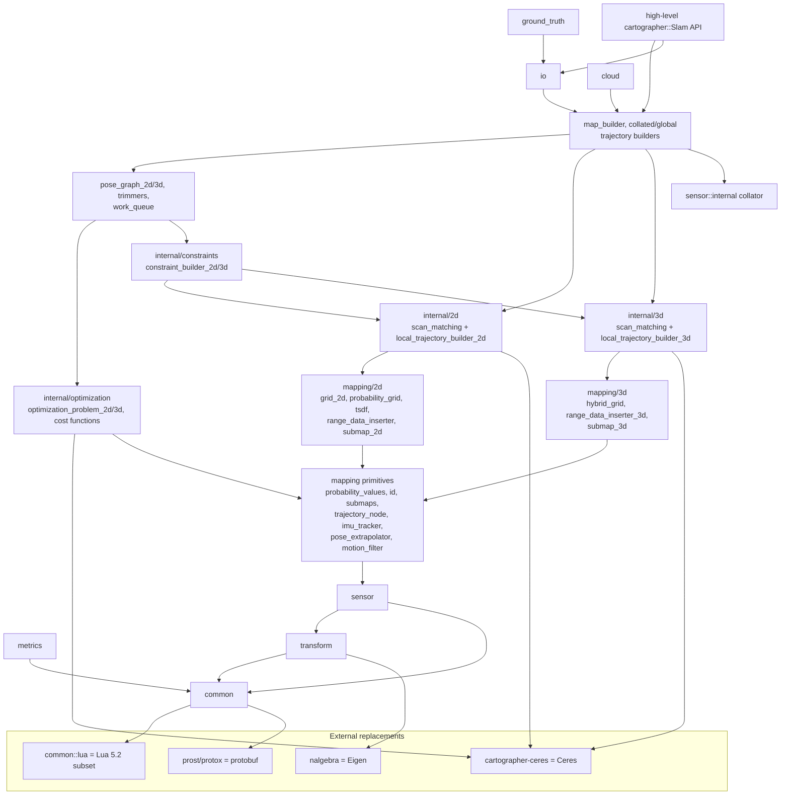
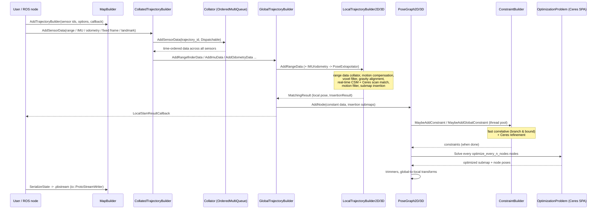

# Cartographer architecture overview (for the Rust port)

Detailed per-area reports:

| Report | Scope |
|---|---|
| [common_transform_metrics.md](common_transform_metrics.md) | time, math, thread pool, Lua dictionary, rigid transforms, metrics |
| [sensor.md](sensor.md) | sensor data types, collators, ordered multi-queue, voxel filters, compressed point clouds |
| [mapping_2d.md](mapping_2d.md) | probability values, 2D grids/submaps, inserters, 2D scan matchers, local trajectory builder 2D, extrapolator |
| [mapping_3d.md](mapping_3d.md) | hybrid grid, 3D submaps, 3D scan matchers, rotational matcher, IMU-based extrapolator |
| [pose_graph.md](pose_graph.md) | pose graph 2D/3D, constraint builder, optimization problems, trimmers, map builder |
| [io_ground_truth_cloud.md](io_ground_truth_cloud.md) | points processors, pbstream, serialization/migration, submap painting, ground truth, cloud |
| [protos_and_config.md](protos_and_config.md) | every proto and every Lua option, the Lua subset |

## Module dependency graph

Arrows point from a module to the modules it depends on.

## End-to-end data flow

Threading in C++: sensor data is handled on the caller's thread up to `AddNode`.
`PoseGraph` owns a `WorkQueue` executed on the shared `ThreadPool`
(`num_background_threads`). Constraint search tasks run on the same pool;
optimization runs on a pool thread, with the pose graph mutex released during
`Solve`.

## Port order (leaves first)

1. `cartographer-ceres` (independent; the C++ uses it from `mapping/` only) and
   `common` (time, math, Lua dictionary, thread pool, ceres options), then `transform`, then `metrics`.
2. `sensor` (data types, proto conversions, compressed point cloud, voxel filters,
   map_by_time, ordered multi-queue, collators).
3. Mapping primitives: `id`, `probability_values`, `value_conversion_tables`,
   `trajectory_node`, `imu_tracker`, `pose_extrapolator(_interface)`,
   `motion_filter`, `range_data_collator`, `submaps`, `range_data_inserter_interface`,
   `detect_floors`, `eigen_quaterniond_from_two_vectors`.
4. 2D maps: `xy_index`, `map_limits`, `grid_2d`, `probability_grid`, `tsdf_2d`, `tsd_value_converter`,
   inserters, `ray_to_pixel_mask`, `normal_estimation_2d`, `submap_2d`.
   3D maps (in parallel): `hybrid_grid`, `range_data_inserter_3d`, `submap_3d`.
5. 2D local SLAM (scan matchers, `local_trajectory_builder_2d`). 3D local SLAM in
   parallel (scan matchers, rotational scan matcher, `imu_integration`,
   `imu_based_pose_extrapolator`, `local_trajectory_builder_3d`).
6. Optimization (cost functions, `optimization_problem_2d/3d`) and constraints
   (`constraint_builder_2d/3d`), then `pose_graph_2d/3d`, `pose_graph_trimmer`,
   `overlapping_submaps_trimmer_2d`, `connected_components`,
   `trajectory_connectivity_state`, `work_queue`, `pose_graph_data`.
7. `map_builder`, `collated_trajectory_builder`, `global_trajectory_builder`,
   `local_slam_result_2d/3d`, `submap_controller`.
8. `io` (proto streams, serialization/migration, points processors, painting),
   then `ground_truth`.
9. The high-level `cartographer::Slam` API, end-to-end tests, benchmarks and the report.
10. `cloud` (optional `tonic` feature).
